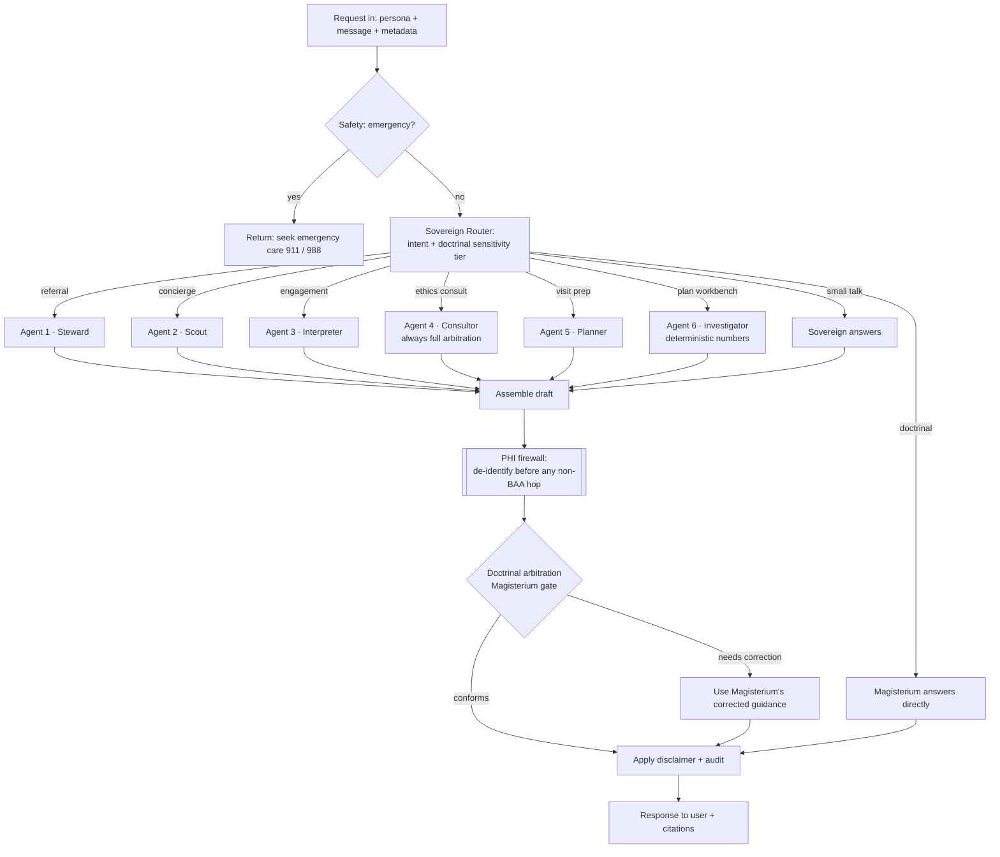

# CosmaNeura Sovereign — Architecture

A single source of healthcare information guided by Catholic teaching, built as a
**Hobbesian Sovereign** orchestrating six specialist AI agents, with
**Magisterium AI** as the doctrinal authority and final arbiter. White-labelled
onto MyCatholicDoctor.

---

## 1. The Hobbesian model (and one important refinement)

In *Leviathan*, subjects covenant to cede their private judgment to a Sovereign
who distributes duties and holds final authority, guaranteeing order. We map that
directly:

- The **Sovereign** receives every request, **distributes the task** to the
  right agent(s), and is the **final arbiter** of what reaches the user.
- The three **agents** are the subjects: competent within their domain, but
  never the last word.

**The refinement that matters for "make no mistakes":** Magisterium AI's API is a
*chat-completions answer engine over Catholic documents* — not a general-purpose
function-calling orchestrator. Asking it to mechanically route "call the trials
API, then rank doctors" would be slow and awkward. So we split the sovereign role
in two, which is actually more faithful to Hobbes (the sovereign holds the *law*
and renders *final judgment*, while administration executes):

| Sovereign role | Implemented by | Hobbesian analogue |
|---|---|---|
| **Doctrinal authority + final judge** | **Magisterium AI** (`magisterium-1` API + MCP) | The law and the supreme court |
| **Mechanical orchestration** (routing, agent calls, assembly) | A general reasoning model (default: **Claude**, BAA-eligible) | The sovereign's administration |

Magisterium remains the **final arbiter**: every answer that touches faith or
morals passes through it before the user sees it. The doctrinal standard is the
**USCCB Ethical and Religious Directives for Catholic Health Care Services (ERDs)**
— the same framework MyCatholicDoctor operates under.

> **Decision (locked): hybrid.** This is the default and the recommended
> production posture. A **literal** version — where Magisterium is consulted on
> *every* request as the task-distributor, not just the final judge — is one
> setting away: `SOVEREIGN_MODE=literal` (or `sovereign_mode` in `Settings`).
> Literal mode adds a Magisterium round-trip to every call: a pure-logistics
> referral that costs **zero** Magisterium calls under hybrid costs **one** under
> literal, before any arbitration. The router and arbiter are isolated so no
> other code changes. See `SETUP_AND_HANDOFF.md`.

---

## 2. Request lifecycle



**Tiered gate** (this is the "harness Magisterium to avoid conflict / speed up
answers" idea): the router tags each request `none | low | high`. Pure logistics
(`none`, e.g. "find a dermatologist in Ohio") **skip** the Magisterium call;
anything with moral weight (`high`, e.g. contraception, IVF, end-of-life) gets
**full** arbitration. This keeps latency and Magisterium spend down without
sacrificing orthodoxy where it counts.

### Two doctrinal touchpoints (gate + optional inline advisory)

Magisterium participates in two distinct ways — defense in depth:

1. **Final arbitration gate (always on).** Every faith/morals-weighted answer
   passes through Magisterium via its REST API before the user sees it. This is
   the authoritative check and it never goes away.
2. **Inline MCP advisory (optional, off by default).** When `SOVEREIGN` is run
   with `MAGISTERIUM_MCP_ENABLED=true`, an agent can consult Magisterium's **MCP
   server** *while it reasons* — via Anthropic's MCP connector — so it frames the
   answer faithfully from the start rather than only being corrected at the gate.
   Today the **Concierge** agent uses this (frontier medicine often brushes
   embryo-destructive research, IVF-adjacent biotech, etc.).

⚠️ **Compliance boundary on the MCP advisory.** Anthropic's MCP connector is
**not ZDR-eligible** and **not available on Bedrock/Vertex**, and Magisterium is
not a business associate. So the inline advisory may only ever see
**de-identified, non-PHI** text. The LLM client enforces this with an
`assert_no_phi` guard that refuses on detected identifiers, and the PHI-bearing
**Engagement** agent never enables it. The always-on REST gate still protects
every path, including the provider/PHI path, using a de-identified summary.

---

## 3. The six agents

| # | Name | Job | Primary data sources | PHI exposure |
|---|---|---|---|---|
| **1** | **Referral / Steward** | When the user wants to see a doctor, find the best match by Catholic-or-not, geography, specialty, language; hand off a booking | **Partner Directory** (MyCatholicDoctor + partners — the only place the "is_catholic" flag + booking links live) → **NPPES NPI Registry** for broad/non-Catholic geography + specialty | None needed (coarse preferences only) |
| **2** | **Concierge / Scout** | Talk intelligently about frontier medicine, biotech, advanced trials, and the specific companies/people relevant to the user | **ClinicalTrials.gov v2** (recruiting trials by condition, sponsor/company, phase, geo). Pluggable: web search, OpenFDA | De-identified interest text only |
| **3** | **Engagement / Interpreter** | Help patient *and* provider understand the patient's history/conditions; raise information level; frame to elevate the doctor-patient visit. **Not diagnostic** | The person's own provided history + general medical-education references | **Highest** — provider mode may hold PHI; handled by the BAA LLM **only** |
| **4** | **Ethics Consult / Consultor** | Prepare a clinician's ethics consult: the question in ERD terms, applicable directives by number, licit alternatives, when to involve the ethics committee/bishop. **Never the final moral word** — the orchestrator forces full Magisterium arbitration on every draft | **PubMed/PMC (NCBI E-utilities)** — general literature + Linacre Quarterly (Catholic bioethics corpus); USCCB ERDs (6th ed.) as framework | Case text may hold PHI → BAA LLM only; PubMed sees a de-identified topic string |
| **5** | **Visit Prep / Planner** | The everyday clinician copilot: recap of prior session(s), talking points, short outline for the upcoming visit. Brief by default; preparation, never prescription | Prior-session notes/transcripts supplied by the calling app (`metadata.prior_sessions`) | **Highest** — session transcripts (behavioral health included); BAA LLM **only**, nothing external |

| **6** | **Plan Workbench / Investigator** | Post-visit deep-dive: labs + history + the clinician's own assessment → levers-organized analysis, separate from the SOAP note. All calories/macros/BMI computed in code (`agents/calculators.py`), never generated | **PubMed** (de-identified topic), deterministic calculators; openFDA/RxNorm/USDA next | **Highest** — labs/history may hold PHI; BAA LLM **only** |

### NPI boundary

The NPPES integration is a read-only public-directory source for referral and
provider matching. It is not part of provider signup, authentication, practice
membership, licensure or credential approval, entitlement, or PHI access.
Sovereign never asks a signed-in provider for an NPI to establish identity and
never returns an NPPES match as proof of authority. Core owns public-provider
onboarding and it must succeed with NPI absent. Any future customer-NPI
collection belongs to a separately approved payer-facing transaction or
integration and is not authorized by this referral client.

Provider credential/licensure status is unverified informational metadata only.
It never grants or blocks signup, trial, billing, continued use, entitlement,
Sovereign capability, or real-PHI access. The practice authorizes workforce
membership and roles; Core separately enforces verified identity, membership and
role, legal/BAA state, subscription/entitlement, tenant and record scope, consent,
capability rollout, and operational PHI controls. Sovereign consumes that
server-resolved authority and must not claim Cosmaneura verified professional
status.

Sovereign does not accept raw audio, video, media chunks, or transient capture
payloads. It receives only minimum-necessary, platform-authorized text/context
for the requested capability. Raw-media deletion and retry custody remain with
the capture/transcription owner under the platform retention contract.

Each agent uses the reasoning LLM for (a) slot extraction from free text and
(b) narration/ranking. Agents 1, 2, 4 and 6 call **non-BAA public APIs**, so
those APIs receive only de-identified text. See `PROVIDER_COPILOT_DESIGN.md` for the
design history of Agents 4-5.

---

## 4. Two personas, two compliance postures

One codebase; the `persona` field selects a `ComplianceProfile`.

| | **Patient build** | **Provider build** |
|---|---|---|
| SOC 2 | ✅ required | ✅ required |
| HIPAA | ❌ not required | ✅ required |
| PHI accepted | No (consumer's own info; sensitive but not covered-entity PHI) | Yes |
| LLM inference | Standard API (ZDR still recommended) | **Must** be BAA-covered: Anthropic 1P API + **Zero Data Retention** + signed BAA, *or* Claude via AWS Bedrock / Google Vertex under their BAA |
| Audit | Local operational only until public lineage exists | Platform-owned durable provider ingestion; external retention/integrity controls remain separate |
| De-identification before non-BAA hops | On | On (with production-grade de-id + human review) |

### The PHI boundary (non-negotiable)
Magisterium, ClinicalTrials.gov, NPPES, PubMed, and any web search are **not**
HIPAA business associates. **PHI must never reach them.** The Sovereign
de-identifies every draft before the Magisterium gate, and non-BAA clients
carry a hard `assert_no_phi` tripwire. The only component allowed to see raw
PHI is the BAA-covered reasoning LLM (the path used by Agents 3, 4, 5 and 6).

> Verified facts behind this design (Anthropic, current): Anthropic signs a BAA
> covering the **first-party Messages API** under qualifying commercial tiers
> **with ZDR**, and maintains **SOC 2 Type II**. The BAA covers *inference only*
> — audit logging, storage, identity, and de-identification are the customer's
> responsibility, which is why they live in this repo.

---

## 5. Model / API / MCP inventory (all publicly available)

| Role | Service | How |
|---|---|---|
| Doctrinal authority + final arbiter | **Magisterium AI** | `POST https://www.magisterium.com/api/v1/chat/completions`, model `magisterium-1` (OpenAI-compatible; returns citations). Optional inline advisory via **MCP** (`https://mcp.magisterium.com`, OAuth) using Anthropic's MCP connector (`mcp_servers`, beta header `mcp-client-2025-11-20`) — de-identified text only; not ZDR-eligible; not on Bedrock/Vertex |
| Sovereign brain + agent reasoning | **Claude** (recommended) | Anthropic Messages API; BAA-eligible w/ ZDR. Alternatives: OpenAI (BAA on API), or Claude on Bedrock/Vertex |
| Provider matching | **NPPES NPI Registry v2.1** | Read-only public referral lookup; never onboarding, authentication, or credential proof. `GET https://npiregistry.cms.hhs.gov/api/?version=2.1` (free, no key) |
| Trials / biotech | **ClinicalTrials.gov v2** | `GET https://clinicaltrials.gov/api/v2/studies` (free, no key) |
| Catholic provider set + booking | **Partner Directory adapter** | MyCatholicDoctor feed (TBD) or partner registrations; fixture today |

Optional future MCPs/APIs for Agent 2/3: OpenFDA (drugs/devices), PubMed/Europe
PMC (literature), MedlinePlus (patient education), NIH RePORTER (funded research).

---

## 6. Repository layout

```
cosmaneura-sovereign/
├── app/
│   ├── main.py              FastAPI /chat (+ /healthz)
│   ├── config.py            Settings + ComplianceProfile (patient vs provider)
│   ├── schemas.py           Request/response + Intent/Sensitivity enums
│   ├── sovereign/
│   │   ├── router.py        Intent + doctrinal-sensitivity classification
│   │   ├── arbiter.py       Magisterium gate (answer + review)
│   │   └── orchestrator.py  The Sovereign: route → dispatch → arbitrate → finalize
│   ├── agents/
│   │   ├── referral_agent.py    Agent 1 (Steward)
│   │   ├── concierge_agent.py   Agent 2 (Scout)
│   │   └── engagement_agent.py  Agent 3 (Interpreter)
│   ├── clients/
│   │   ├── magisterium.py       Magisterium API
│   │   ├── llm.py               Reasoning LLM (Anthropic) + mock brain
│   │   ├── nppes.py             NPI Registry
│   │   ├── clinicaltrials.py    ClinicalTrials.gov v2
│   │   ├── partner_directory.py MyCatholicDoctor + partners adapter
│   │   └── partners_fixture.json
│   └── compliance/
│       ├── phi.py           De-identification + PHI boundary tripwire
│       ├── audit.py         HIPAA-aware audit (hashes content, never stores it)
│       └── safety.py        Emergency detection + non-diagnostic disclaimers
├── tests/test_pipeline.py
├── run_demo.py              Full pipeline, mock mode, zero credentials
├── requirements.txt · .env.example · Makefile
```

**Separate repo: yes (for now).** Cleaner compliance boundary, independent
deploy cadence, and isolated secrets from the main CosmaNeura stack. The
patient and provider products share this one codebase and differ only by
profile + which LLM path is configured — so there's no logic to duplicate. When
the boundary is proven you can fold it into the monorepo behind the same module
seams.
