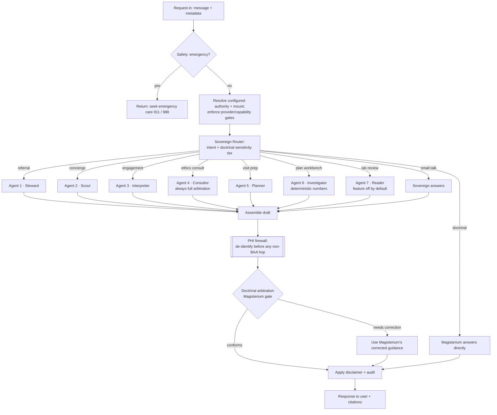

# Sovereign — Architecture

Sovereign is a named dark beta for healthcare-information orchestration guided
by Catholic teaching and designed for MyCatholicDoctor. It is built as a
**Hobbesian Sovereign** orchestrating seven specialist AI agents, with
**Magisterium AI** as the doctrinal authority and final arbiter.

There are no Sovereign production resources. A merge to `main` does not deploy.
The production job is founder-only and remains blocked while
`SOVEREIGN_DEPLOY_ENABLED` is off; that latch stays off for this beta.

---

## 1. The Hobbesian model (and one important refinement)

In *Leviathan*, subjects covenant to cede their private judgment to a Sovereign
who distributes duties and holds final authority, guaranteeing order. We map that
directly:

- The **Sovereign** receives every request, **distributes the task** to the
  right agent(s), and is the **final arbiter** of what reaches the user.
- The seven specialist **agents** are the subjects: competent within their
  domain, but never the last word.

**The refinement that matters for "make no mistakes":** Magisterium AI's API is a
*chat-completions answer engine over Catholic documents* — not a general-purpose
function-calling orchestrator. Asking it to mechanically route "call the trials
API, then rank doctors" would be slow and awkward. So we split the sovereign role
in two, which is actually more faithful to Hobbes (the sovereign holds the *law*
and renders *final judgment*, while administration executes):

| Sovereign role | Implemented by | Hobbesian analogue |
|---|---|---|
| **Doctrinal authority + final judge** | **Magisterium AI** (`magisterium-1` API + MCP) | The law and the supreme court |
| **Mechanical orchestration** (routing, agent calls, assembly) | A general reasoning model (default: **Claude**, BAA-eligible) | The sovereign's administration |

Magisterium remains the **final arbiter**: every answer that touches faith or
morals passes through it before the user sees it. The doctrinal standard is the
**USCCB Ethical and Religious Directives for Catholic Health Care Services (ERDs)**
— the same framework MyCatholicDoctor operates under.

> **Decision (locked): hybrid.** This is the configured beta default. A
> **literal** version — where Magisterium is consulted on
> *every* request as the task-distributor, not just the final judge — is one
> setting away: `SOVEREIGN_MODE=literal` (or `sovereign_mode` in `Settings`).
> Literal mode adds a Magisterium round-trip to every call: a pure-logistics
> referral that costs **zero** Magisterium calls under hybrid costs **one** under
> literal, before any arbitration. The router and arbiter are isolated so no
> other code changes. See `SETUP_AND_HANDOFF.md`.

---

## 2. Request lifecycle



**Tiered gate** (this is the "harness Magisterium to avoid conflict / speed up
answers" idea): the router tags each request `none | low | high`. Pure logistics
(`none`, e.g. "find a dermatologist in Ohio") **skip** the Magisterium call;
anything with moral weight (`high`, e.g. contraception, IVF, end-of-life) gets
**full** arbitration. This keeps latency and Magisterium spend down without
sacrificing orthodoxy where it counts.

### Two doctrinal touchpoints (gate + optional inline advisory)

Magisterium participates in two distinct ways — defense in depth:

1. **Final arbitration gate (always on).** Every faith/morals-weighted answer
   passes through Magisterium via its REST API before the user sees it. This is
   the authoritative check and it never goes away.
2. **Inline MCP advisory (optional, off by default).** When `SOVEREIGN` is run
   with `MAGISTERIUM_MCP_ENABLED=true`, an agent can consult Magisterium's **MCP
   server** *while it reasons* — via Anthropic's MCP connector — so it frames the
   answer faithfully from the start rather than only being corrected at the gate.
   Today the **Concierge** agent uses this (frontier medicine often brushes
   embryo-destructive research, IVF-adjacent biotech, etc.).

⚠️ **Compliance boundary on the MCP advisory.** Anthropic's MCP connector is
**not ZDR-eligible** and **not available on Bedrock/Vertex**, and Magisterium is
not a business associate. So the inline advisory may only ever see
**de-identified, non-PHI** text. The LLM client enforces this with an
`assert_no_phi` guard that refuses on detected identifiers, and the
provider-oriented **Engagement** agent never enables it. The REST gate reviews
faith- or morals-weighted output using a de-identified summary.

---

## 3. The seven agents

| # | Name | Job | Primary data sources | PHI exposure |
|---|---|---|---|---|
| **1** | **Referral / Steward** | When the user wants to see a doctor, find the best match by Catholic-or-not, geography, specialty, language; hand off a booking | **Partner Directory** (MyCatholicDoctor + partners — the only place the "is_catholic" flag + booking links live) → **NPPES NPI Registry** for broad/non-Catholic geography + specialty | None needed (coarse preferences only) |
| **2** | **Concierge / Scout** | Talk intelligently about frontier medicine, biotech, advanced trials, and the specific companies/people relevant to the user | **ClinicalTrials.gov v2** (recruiting trials by condition, sponsor/company, phase, geo). Pluggable: web search, OpenFDA | De-identified interest text only |
| **3** | **Engagement / Interpreter** | Help a patient or provider understand supplied history/conditions; raise information level; frame questions for a better doctor-patient visit. **Not diagnostic** | Caller-supplied non-PHI beta context + general medical-education references | Future provider use requires the gated BAA-eligible path; beta input stays synthetic |
| **4** | **Ethics Consult / Consultor** | Prepare a clinician's ethics consult: the question in ERD terms, applicable directives by number, licit alternatives, when to involve the ethics committee/bishop. **Never the final moral word** — the orchestrator forces full Magisterium arbitration on every draft | **PubMed/PMC (NCBI E-utilities)** — general literature + Linacre Quarterly (Catholic bioethics corpus); USCCB ERDs (6th ed.) as framework | Future provider use requires the gated BAA-eligible path; PubMed receives only a de-identified topic string |
| **5** | **Visit Prep / Planner** | Prepare brief talking points and an outline from the minimum-necessary context supplied for the current request. Preparation only; never prescription | Caller-supplied text context; Sovereign does not ingest or retain raw visit media | Future provider context may contain PHI and therefore requires the gated BAA-eligible path; nothing identifiable goes to uncovered services |
| **6** | **Plan Workbench / Investigator** | Analyze caller-supplied labs, history, and clinician assessment by care-plan lever. Calories/macros/BMI are computed in code (`agents/calculators.py`), never generated | **PubMed** (de-identified topic), deterministic calculators; openFDA/RxNorm/USDA next | Future provider context may contain PHI and therefore requires the gated BAA-eligible path |
| **7** | **Lab Review / Reader** | Feature-gated review of normalized lab data; non-diagnostic and disabled by default | athenahealth FHIR adapter scaffold; sandbox/synthetic use only while `FEATURE_ATHENA_LABS=false` | Future provider-only path; no live athenahealth or PHI use is authorized by this beta |

### NPI boundary

The NPPES integration is a read-only public-directory source for referral and
provider matching. It is not signup, authentication, practice membership,
licensure or credential approval, entitlement, or PHI access. Sovereign never
uses an NPI to establish identity and never returns an NPPES match as proof of
authority. There is no public Sovereign signup or production provider mount.

Provider credential/licensure data is unverified informational metadata only.
The named beta does not grant provider capability or real-PHI access and must
not claim CosmaNeura verified professional status. Any future host identity or
authorization integration requires separate review; Sovereign is not the
Cosmas PHI hub and assumes no Cosmas record-retention contract.

Sovereign exposes no raw audio, video, or media-upload path. Provider-oriented
request fields can carry synthetic visit context for scaffold testing, but
Sovereign does not persist it and real visit material is not authorized. The
current beta uses only synthetic or non-PHI text.

Each agent uses the reasoning LLM for (a) slot extraction from free text and
(b) narration/ranking. Agents that call **uncovered public APIs** send only
de-identified text. Agent 7 and its athenahealth adapter remain disabled.

---

## 4. Two personas, two beta postures

One codebase; resolved runtime authority selects a `ComplianceProfile`. A body
`persona` does not grant access to the provider path.

| | **Patient path (current beta scope)** | **Provider path (gated scaffold)** |
|---|---|---|
| Data boundary | Non-PHI only | No live use; any future PHI path requires independent authorization and review |
| Compliance status | No compliance certification is claimed | `BAA_ATTESTED` is an operator self-attestation, not a certification or proof of coverage |
| LLM inference | Standard API; send no PHI | Must use a BAA-eligible service under an applicable executed agreement, with any required ZDR configuration |
| Audit / retention | Hash-only local development events; no production persistence | No production persistence or provider-record retention exists |
| De-identification before uncovered hops | Enforced as defense in depth | Baseline exists; validated de-identification and human review are prerequisites to any future real-PHI use |

### The PHI boundary (non-negotiable)
Magisterium, ClinicalTrials.gov, NPPES, PubMed, and other public services are
outside a provider PHI boundary. **PHI must never reach them.** Sovereign
de-identifies drafts before the Magisterium gate, and uncovered clients carry a
hard `assert_no_phi` tripwire. Any future provider path must keep identifiable
data inside its separately validated, BAA-eligible service boundary; Agents
3–7 do not make the beta a live PHI product.

> BAA eligibility depends on the exact vendor, account, service, agreement, and
> runtime configuration. `BAA_ATTESTED=true` records an operator's
> self-attestation only. It neither proves HIPAA compliance nor authorizes real
> PHI in Sovereign.

---

## 5. Model / API / MCP inventory

This is an implementation inventory, not evidence that an integration or
production resource is active.

| Role | Service | How |
|---|---|---|
| Doctrinal authority + final arbiter | **Magisterium AI** | `POST https://www.magisterium.com/api/v1/chat/completions`, model `magisterium-1` (OpenAI-compatible; returns citations). Optional inline advisory via **MCP** (`https://mcp.magisterium.com`, OAuth) using Anthropic's MCP connector (`mcp_servers`, beta header `mcp-client-2025-11-20`) — de-identified text only; not ZDR-eligible; not on Bedrock/Vertex |
| Sovereign brain + agent reasoning | **Anthropic or Azure OpenAI** | The two providers wired in `LLMClient`. Any future PHI use depends on the exact account, service, agreement, and runtime configuration |
| Provider matching | **NPPES NPI Registry v2.1** | Read-only public referral lookup; never onboarding, authentication, or credential proof. `GET https://npiregistry.cms.hhs.gov/api/?version=2.1` (free, no key) |
| Trials / biotech | **ClinicalTrials.gov v2** | `GET https://clinicaltrials.gov/api/v2/studies` (free, no key) |
| Catholic provider set + booking | **Partner Directory adapter** | MyCatholicDoctor feed (TBD) or partner registrations; fixture today |

Optional future MCPs/APIs for Agent 2/3: OpenFDA (drugs/devices), PubMed/Europe
PMC (literature), MedlinePlus (patient education), NIH RePORTER (funded research).

---

## 6. Repository layout

```
cosmaneura-sovereign/
├── app/
│   ├── main.py              FastAPI /chat (+ /healthz)
│   ├── config.py            Settings + ComplianceProfile (patient vs provider)
│   ├── schemas.py           Request/response + Intent/Sensitivity enums
│   ├── sovereign/
│   │   ├── router.py        Intent + doctrinal-sensitivity classification
│   │   ├── arbiter.py       Magisterium gate (answer + review)
│   │   └── orchestrator.py  The Sovereign: route → dispatch → arbitrate → finalize
│   ├── agents/
│   │   ├── referral_agent.py    Agent 1 (Steward)
│   │   ├── concierge_agent.py   Agent 2 (Scout)
│   │   ├── engagement_agent.py  Agent 3 (Interpreter)
│   │   ├── ethics_agent.py      Agent 4 (Consultor)
│   │   ├── visit_prep_agent.py  Agent 5 (Planner)
│   │   ├── plan_workbench_agent.py Agent 6 (Investigator)
│   │   └── labs_agent.py        Agent 7 (Reader; feature-gated)
│   ├── clients/
│   │   ├── magisterium.py       Magisterium API
│   │   ├── llm.py               Reasoning LLM (Anthropic) + mock brain
│   │   ├── nppes.py             NPI Registry
│   │   ├── clinicaltrials.py    ClinicalTrials.gov v2
│   │   ├── pubmed.py             PubMed/PMC
│   │   ├── labs.py               Normalized lab-source interface
│   │   ├── athena/               Feature-gated athenahealth adapter
│   │   ├── partner_directory.py MyCatholicDoctor + partners adapter
│   │   └── partners_fixture.json
│   └── compliance/
│       ├── phi.py           De-identification + PHI boundary tripwire
│       ├── audit.py         Hash-only audit (never stores content)
│       └── safety.py        Emergency detection + non-diagnostic disclaimers
├── tests/test_pipeline.py
├── run_demo.py              Full pipeline, mock mode, zero credentials
├── requirements.txt · .env.example · Makefile
```

Sovereign remains its own named dark-beta repository. It is not folded into the
Cosmas PHI hub and has no production resources. The patient and provider paths
share this codebase but retain separate runtime gates and data boundaries.
